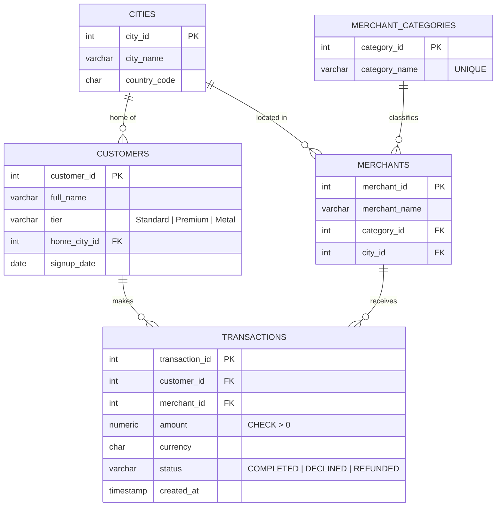

# Fintech Transactions Database (PostgreSQL)

A relational database for a digital-banking card payments system, with analytics queries that answer typical business questions: where customers spend, which customers and merchants matter most, how volume trends month to month, and where payments fail.

The project started as a university Database Systems assignment and was redesigned and extended: a new domain, a normalized schema with constraints and indexes, a larger dataset, and more queries (subqueries, HAVING, CASE, conditional aggregation, views).

**Tech:** PostgreSQL 16 · SQL (DDL, DML, joins, subqueries, aggregation, views)

---

## Data model



### Design decisions

- **Third normal form (3NF).** Each fact is stored once. A merchant's category lives on the merchant, not on every transaction, so recategorizing a merchant is a single-row update.
- **Integrity in the database, not the application.** Primary and foreign keys, `NOT NULL`, `UNIQUE`, and `CHECK` constraints (positive amounts, allowed tiers and statuses) reject invalid data at insert time.
- **Money as `NUMERIC(12,2)`.** Exact decimal arithmetic, with no floating-point rounding errors.
- **Transaction status instead of deletion.** Declined and refunded payments are kept for auditing; reports filter on `status = 'COMPLETED'` when measuring spend.
- **Indexes** on all foreign keys and on `created_at`, the columns the queries join and group by most.

---

## Queries

All queries are in [`queries/03_analytics_queries.sql`](queries/03_analytics_queries.sql), each commented with the business question it answers.

| # | Business question | SQL concepts |
|---|---|---|
| Q1 | Where does customer money go, by category? | JOIN, GROUP BY, aggregates |
| Q2 | Which payments were over EUR 300, and where? | Multi-table JOIN, filtering |
| Q3 | Which customers never used their card? | `NOT EXISTS` subquery |
| Q4 | How active is every customer, including inactive ones? | `LEFT JOIN`, `COALESCE` |
| Q5 | Which merchants generate the most revenue? | GROUP BY, `HAVING` |
| Q6 | Do premium tiers spend more per payment? | Scalar subquery |
| Q7 | Which customers spend more than the average customer? | `HAVING` with a subquery, derived table |
| Q8 | How is monthly volume trending? | Grouping by a date expression (`TO_CHAR`) |
| Q9 | How many customers are low, medium or high spenders? | `CASE`, derived table, `LEFT JOIN` |
| Q10 | Where do payments fail most often? | Conditional aggregation with `SUM(CASE …)` |

A reusable reporting view, `v_monthly_customer_spend`, is defined in [`views/04_reporting_views.sql`](views/04_reporting_views.sql).

### Two details worth noting

**Q3 uses `NOT EXISTS` instead of `NOT IN`.** If the subquery of a `NOT IN` ever returns a `NULL`, the whole condition evaluates to unknown and the query silently returns no rows. `NOT EXISTS` doesn't have this problem.

**Q4 puts the status filter in the `ON` clause.** Filtering the right-hand table in `WHERE` would remove the rows where it is `NULL`, turning the `LEFT JOIN` into an inner join and dropping inactive customers from the report:

```sql
FROM customers c
LEFT JOIN transactions t
       ON t.customer_id = c.customer_id
      AND t.status = 'COMPLETED'      -- in ON, not WHERE
```

### Sample results

**Q8 – Monthly payment volume (EUR)**

| month | transactions | monthly volume | avg ticket |
|---|---|---|---|
| 2026-01 | 16 | 2,342.64 | 146.42 |
| 2026-02 | 19 | 2,438.91 | 128.36 |
| 2026-03 | 25 | 4,853.89 | 194.16 |
| 2026-04 | 21 | 4,117.92 | 196.09 |
| 2026-05 | 34 | 4,945.18 | 145.45 |
| 2026-06 | 27 | 5,076.84 | 188.03 |

Monthly volume roughly doubled from Q1 to Q2.

**Q6 – Average ticket by tier**

| tier | transactions | avg ticket | overall avg ticket |
|---|---|---|---|
| Metal | 33 | 234.67 | 167.43 |
| Standard | 65 | 148.39 | 167.43 |
| Premium | 44 | 145.13 | 167.43 |

Metal customers spend about 40% more per payment than average, while Premium and Standard are close to each other. In this dataset the Premium tier does not translate into larger payments.

**Q10 – Decline rate by category**

| category | attempts | declined | refunded | decline rate |
|---|---|---|---|---|
| Utilities | 34 | 5 | 0 | 14.7% |
| Dining | 27 | 2 | 1 | 7.4% |
| Electronics | 29 | 2 | 2 | 6.9% |
| Groceries | 23 | 1 | 1 | 4.3% |
| Travel | 26 | 1 | 3 | 3.8% |
| Entertainment | 21 | 0 | 0 | 0.0% |

---

## Running it

Requires PostgreSQL (tested on 16).

```bash
createdb fintech

psql -d fintech -f schema/01_create_tables.sql
psql -d fintech -f data/02_seed_data.sql
psql -d fintech -f views/04_reporting_views.sql
psql -d fintech -f queries/03_analytics_queries.sql
```

The schema script drops and recreates the tables, so it can be rerun safely.

## Project structure

```
fintech-transactions-sql/
├── README.md
├── schema/
│   └── 01_create_tables.sql      tables, constraints, indexes
├── data/
│   └── 02_seed_data.sql          sample data (6 cities, 20 customers, 12 merchants, 160 transactions)
├── queries/
│   └── 03_analytics_queries.sql  10 analytics queries
└── views/
    └── 04_reporting_views.sql    reporting view
```

## Data

All data is synthetic and fictional (January–June 2026, amounts in EUR). Customer 20 has no transactions on purpose, to test the inactive-customer queries.
